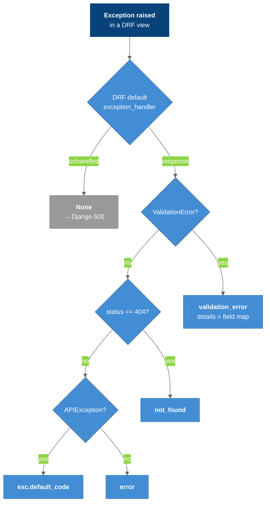

The one error shape every VIP API response uses: `{code, message, details}`. It is part of the frontend↔backend contract.

---

## Overview

The frontend's `CLAUDE.md` §9 asks for predictable error responses. The backend enforces this with a custom DRF exception handler registered in `settings.REST_FRAMEWORK["EXCEPTION_HANDLER"]`.

```json
{
  "code": "validation_error",
  "message": "The request contains invalid data.",
  "details": { "end_datetime": ["end_datetime must be greater than or equal to start_datetime."] }
}
```

---

## Mapping — `events/exceptions.py → drf_exception_handler`

| Exception | Status | `code` | `message` | `details` |
|-----------|--------|--------|-----------|-----------|
| `ValidationError` | 400 | `validation_error` | "The request contains invalid data." | Field-error map. A non-dict detail becomes `{"non_field_errors": [...]}` |
| DRF `NotFound` / Django `Http404` | 404 | `not_found` | "The requested resource could not be found." | `{}` |
| Other `APIException` (e.g. 405) | varies | `exc.default_code` (e.g. `method_not_allowed`) | `str(exc.detail)` | `{}` |
| Other handled | varies | `error` | "An error occurred." | `{}` |
| Unhandled (500) | 500 | — | Django's default 500 handling (the handler returns `None`) | — |



### Legend

- **Dark blue** = entry point
- **Blue** = envelope outputs
- **Gray** = falls through to Django

---

## Rules for New Endpoints

- Raise DRF exceptions (`ValidationError`, `NotFound`, etc.) rather than building error responses by hand.
- The frontend must still validate on its own and handle every `code`. It must not duplicate backend business rules.
- The same shape is documented in `SPECTACULAR_SETTINGS["DESCRIPTION"]`, so Swagger shows it.

---

## Key Files

| File | Purpose |
|------|---------|
| `events/exceptions.py` | `drf_exception_handler` |
| `backend/settings.py` | Registers the handler |

---

## Related Notes

- [[Events_API]]
- [[OpenAPI_Swagger]]
- [[Content_Data_Contract]]
- [[05-Component-Backend]]
