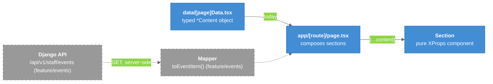

# Content Data Contract

How page content is separated from presentation so a `data/<page>Data.tsx` object can later be swapped for an API or CMS response with **no component changes**. This is frontend `CLAUDE.md` §6.8.

---

## Overview

Phase 1 has no CMS and no data-fetching layer, on purpose. Every section is built "as if its props will one day arrive as JSON." That's what makes backend integration a data-source change rather than a rewrite. The Events page is the first test of this: on the unmerged `feature/events` branch, `lib/api/events.ts` fetches from Django and `toEventItem()` maps the response to the existing `EventItem` props, with no card component changes. See [[Events_API_Integration]].

### Legend

- **Blue** = current
- **Gray, dashed** = not on `main` yet (built on the unmerged `feature/events` branches)

---

## Rules

- One exported `XProps` type per section. The same type types its `*Content` object. **Types are the contract.**
- No hard-coded copy, URLs, or image paths inside sections. Only UI-chrome strings, and those can be overridden where reasonable.
- Content must serialize to JSON: strings, numbers, booleans, string unions, arrays of objects with a stable `id`/`slug`, and string asset paths.
  - No JSX or functions in content.
  - Icons are string keys resolved through a map, e.g. `icon: "map-pin"`.
- Handle variable content: 0, 1, or many items, long or short copy, and missing optional fields. Use defaults, never `!`.
- Split content (text, media, links) from presentation (`layout`, `variant`, `accent`, `className`). A CMS or API can own content while code owns presentation.
- Media is a path plus `alt` (`""` if decorative). No S3 URLs. Files come from the API later ([[AWS_Architecture]]).
- Once a documented API contract exists, derive the frontend type from it.

---

## Key Files

| File | Purpose |
|------|---------|
| `data/*.ts(x)` | Content objects, one per page |
| `components/modular_sections/*` | `XProps` types |
| `vip-web-frontend/CLAUDE.md` §5.3, §6.8, §9 | The written rules |

---

## Related Notes

- [[Modular_Sections]]
- [[Events_Page]]
- [[Error_Envelope]]
- [[Payload_CMS_Branch]]
