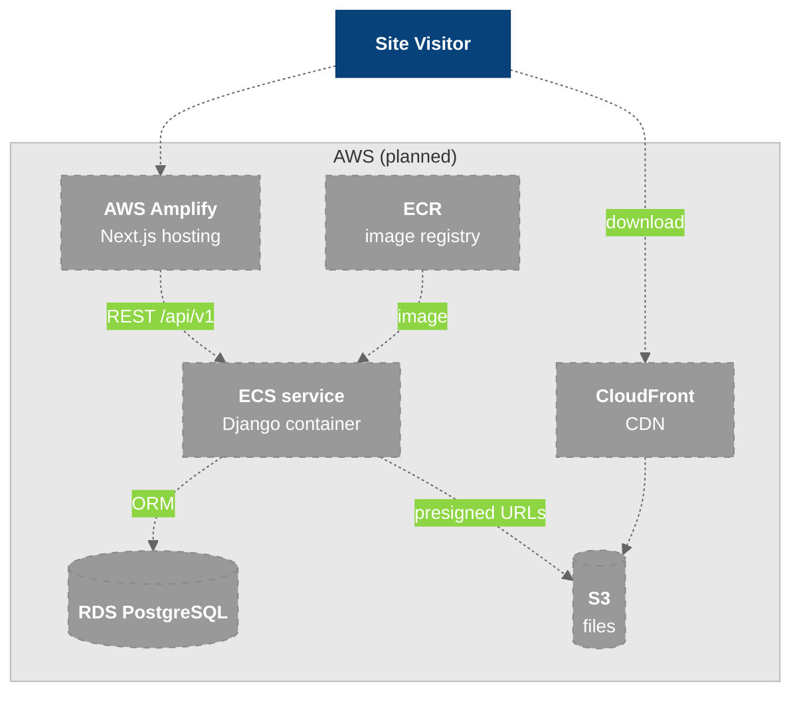

# AWS Architecture *(planned)*

The target AWS hosting for VIP. **None of this is built yet.** It comes from the frontend `CLAUDE.md` §3 and §5.4, and my supervisor owns the infrastructure side.

---

## Overview

### Legend

- **Dark blue** = users
- **Gray, dashed** = planned, not built

---

## Planned Pieces

| Piece | Role | Known requirements |
|-------|------|--------------------|
| AWS Amplify | Frontend hosting | Phase 1 launch target |
| ECR + ECS | Backend container registry and service | The `Dockerfile` exists but still runs `runserver`. It needs a production WSGI server (e.g. gunicorn) first |
| RDS PostgreSQL | Production DB | The same RDS is used by the `payload` schema on [[Payload_CMS_Branch]] |
| S3 + CloudFront | Files and downloads | The frontend asks the API for a download URL. It never builds S3 URLs or hard-codes bucket names |
| Health checks | ECS/ALB target health | `/healthz/` is ready. See [[Health_Endpoints]] |

## Open Items

- A test environment, so a deployed frontend can read a hosted backend (flagged in [[OneOnOne_2026-09-25_Backend_Infra]]).
- Bearer-token auth on staff write routes before anything is public.
- Secrets management for `DJANGO_SECRET_KEY` and the DB credentials.

---

## Related Notes

- [[Tech_Stack]]
- [[03-Container]]
- [[Docker_Local_Dev]]
- [[Project_Phases]]
