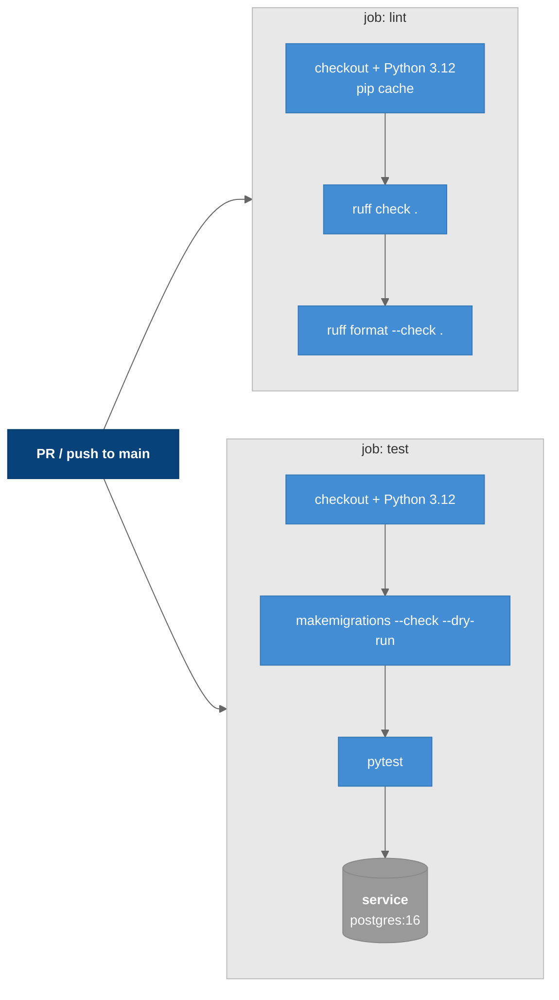

# CI — GitHub Actions

The backend's continuous-integration pipeline, `.github/workflows/ci.yml`. The frontend has no CI workflow in the repo.

---

## Overview

Triggers:

- every `pull_request`
- `push` to `main` or to `feature/github-actions`. The second branch is temporary; drop it once CI is proven.

`concurrency: ci-${{ github.ref }}` with `cancel-in-progress` means a newer run cancels an older one.

### Legend

- **Dark blue** = trigger
- **Blue** = steps
- **Gray** = service container
- **Light gray** = job boundary

---

## Jobs

| Job | Steps | Notes |
|-----|-------|-------|
| `lint` | ruff check, ruff format --check | No DB needed |
| `test` | migrations check, pytest | `postgres:16` service with a `pg_isready` health check. Env values are CI-only throwaways (`DJANGO_SECRET_KEY: ci-only-insecure-key`, `vip_ci` DB/user). They are not secrets |

The **migrations check** fails the build if a model change was committed without its migration.

---

## Future Hooks

A merge to `main` is the natural trigger for auto-updating this vault. See the `vip-docs-sync` skill and [[Project_Structure]].

---

## Related Notes

- [[Testing]]
- [[Configuration]]
- [[GitHub_Actions_CI]]
