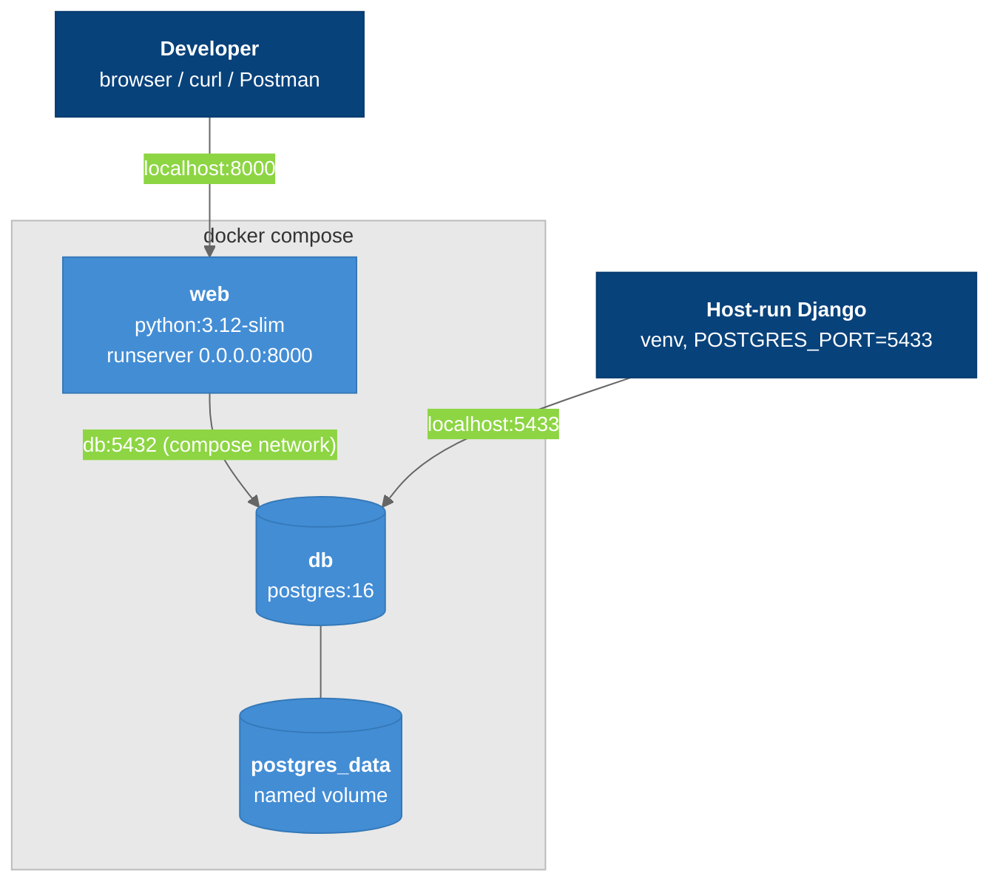

# Docker Local Dev

How the backend runs locally with Docker Compose: a Django `web` container and a PostgreSQL 16 `db` container.

---

## Overview



### Legend

- **Dark blue** = developer entry points
- **Blue** = containers and volume
- **Light gray** = compose boundary

---

## Services

| Service | Image | Ports | Notes |
|---------|-------|-------|-------|
| `web` | built from `Dockerfile` (`python:3.12-slim`) | `8000:8000` | Bind-mounts `.:/app` for hot reload. Env: `POSTGRES_HOST=db`, `POSTGRES_PORT=5432`. `depends_on: db: condition: service_healthy` |
| `db` | `postgres:16` | `5433:5432` | `env_file: .env`. Healthcheck `pg_isready` every 5s, 5 retries. Data in the `postgres_data` volume |

**Why 5433:** a native local Postgres already listens on `127.0.0.1:5432` and would silently shadow the container. Host-run Django uses `.env`'s `POSTGRES_PORT=5433`. Compose overrides it to `5432` for `web`.

---

## Commands

```bash
cp .env.example .env              # then set DJANGO_SECRET_KEY + POSTGRES_PASSWORD
docker compose up --build         # Docker Desktop (Colima: docker-compose)
curl -i http://localhost:8000/healthz/
docker compose up -d db           # DB only, for host-run Django
docker compose down               # keep data
docker compose down -v            # wipe the database volume
```

Both engines are supported: **Docker Desktop** or **Colima** (macOS, CLI only). The README covers both.

---

## Key Files

| File | Purpose |
|------|---------|
| `Dockerfile` | Image. Installs deps first so the layer caches |
| `docker-compose.yml` | Services, healthcheck, volume |
| `.dockerignore` | Build context exclusions |
| `.env.example` | Variables. See [[Configuration]] |

---

## Related Notes

- [[Configuration]]
- [[Health_Endpoints]]
- [[Backend_Docker_Setup]]
- [[PostgreSQL_Setup]]
