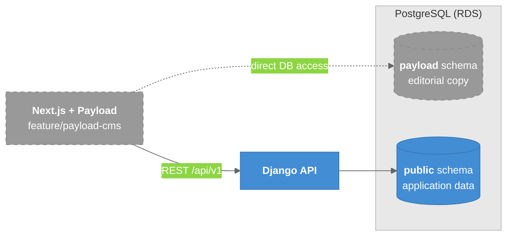

# Payload CMS Branch *(unmerged)*

An experiment on `vip-web-frontend` `origin/feature/payload-cms` (unmerged since 2026-07-22) that embeds Payload CMS in the Next.js app, talking **directly** to the shared Postgres.

---

## Overview

- Payload stores its data in a `payload` schema in the same RDS PostgreSQL that Django uses.
- That branch's `CLAUDE.md` §5.5 splits ownership: **Payload owns editorial page copy, Django owns application data.**
- It never says which side owns **events**.
- `staging`'s `CLAUDE.md` §6.8 still says "No CMS has been chosen yet." The two branches contradict each other.

### Legend

- **Blue** = current
- **Gray, dashed** = unmerged experiment

---

## Why It Matters

- **Don't assume either answer** on events ownership. Events are currently being built in Django ([[Events_API_Integration]]).
- A CMS writing directly to the DB bypasses the API boundary ([[Content_Data_Contract]]). That needs a decision before Phase 2.

---

## Related Notes

- [[Content_Data_Contract]]
- [[AWS_Architecture]]
- [[01-SystemLandscape]]
