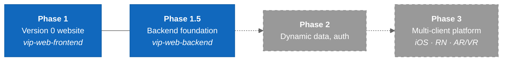

# Project Phases

VIP delivery phases and what each one allows. Summarized from `vip-web-frontend/CLAUDE.md` §2 and §5.1.

---

## Overview

### Legend

- **Blue** = active phases (run in parallel)
- **Gray, dashed** = future phases

---

## Phase 1 — Version 0 Website (frontend)

- Public site, approved sitemap and wireframes, responsive layouts, accessibility, brand.
- Static or lightweight content. Public resource and document downloads.
- Launches on **AWS Amplify**.
- Must not depend on a production backend unless a requirement explicitly needs one.

## Phase 1.5 — Backend Foundation (backend, in parallel)

Done so far:

- Docker + Postgres
- health check
- DRF
- events CRUD
- the error envelope
- OpenAPI docs
- CI

Next:

- ECS/ECR deployment prep
- S3 file access
- the first frontend integration ([[Events_API_Integration]])

The frontend must not assume an endpoint exists until it is documented.

## Phase 2 and 3 — Future

- Dynamic data, authentication, multi-client support.
- Django becomes the shared business-logic layer for Next.js, iOS, React Native, and AR/VR clients.

---

## Things Phase 1 Must Not Add

Unless a feature actually needs them:

- authentication
- complex role systems
- message queues
- microservices
- event-driven infrastructure
- advanced caching
- search clusters
- background workers
- unnecessary abstractions

---

## Related Notes

- [[Tech_Stack]]
- [[01-SystemLandscape]]
- [[AWS_Architecture]]
