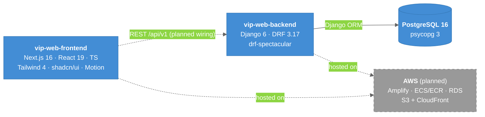

# Tech Stack

Technologies used across the whole VIP project: frontend, backend, data, infrastructure, and tooling. Each is marked **current** (in `main` today) or **planned**.

---

## Overview

VIP is two independently deployable repos that talk only through a documented, versioned REST contract (`/api/v1/...`):

- **`vip-web-frontend`** — the public website (Phase 1).
- **`vip-web-backend`** — the Django API that will become the shared business-logic and data layer for every future client: web, iOS, React Native, and AR/VR (Phase 1.5).

### Legend

- **Blue** = VIP containers (what we build)
- **Gray, dashed** = planned, not built
- **Dashed arrow** = planned relationship

---

## Frontend — `vip-web-frontend` (current)

| Technology | Version | Purpose |
|-----------|---------|---------|
| Next.js (App Router) | 16.2.9 | Framework, routing, Server Components |
| React / React DOM | 19.2.4 | UI |
| TypeScript | ^5 | Types everywhere (`.ts` / `.tsx`) |
| Tailwind CSS | ^4 (`@tailwindcss/postcss`) | Styling; brand tokens in `app/globals.css` |
| shadcn/ui + Radix UI | shadcn ^4.11, radix-ui ^1.6 | Accessible primitives (`components/ui/`) |
| Motion (Framer Motion) | ^12.40 | Animation, gated by `MotionProvider` |
| next-themes | ^0.4.6 | Light/dark theme (`class` attribute, system default) |
| Lucide React | ^1.21 | Icons |
| Embla Carousel | ^8.6 | Carousels |
| three + postprocessing | ^0.185 / ^6.39 | WebGL animated backgrounds (grid-scan) |
| react-fast-marquee | ^1.6 | Logo marquee |
| class-variance-authority, clsx, tailwind-merge | — | Variant and class composition (`cn()` in `lib/utils.ts`) |
| Fonts | — | Gotham (local `.otf`), IBM Plex Sans, IBM Plex Mono |

## Backend — `vip-web-backend` (current)

| Technology | Version | Purpose |
|-----------|---------|---------|
| Python | 3.12 | Runtime (`python:3.12-slim` image) |
| Django | 6.0.6 | Web framework, ORM, admin |
| Django REST Framework | 3.17.1 | API views, serializers, exception handling |
| drf-spectacular | 0.30.0 | OpenAPI 3 schema + Swagger UI |
| psycopg[binary] | 3.2.13 | PostgreSQL driver |
| python-dotenv | 1.2.2 | Loads `.env` (`override=False`) |
| PostgreSQL | 16 | Relational database (Docker locally) |

## Tooling & Testing

| Area | Frontend | Backend |
|------|----------|---------|
| Lint | ESLint 9 + `eslint-config-next` + `jsx-a11y` | Ruff 0.15 (`E,F,I,UP,B,W`, line length 100) |
| Format | — | `ruff format` (double quotes) |
| Types | `tsc --noEmit` | — |
| Tests | Manual + axe-core in dev; Playwright installed | pytest 9 + pytest-django 4.12 |
| CI | none in repo | GitHub Actions: lint job + test job with a Postgres 16 service |
| API exploration | — | Swagger UI `/api/docs/`, Postman collection |

## Infrastructure

| Piece | Status | Notes |
|-------|--------|-------|
| Docker + Docker Compose | **current** | `web` (Django) + `db` (postgres:16), named volume |
| GitHub Actions | **current** | Backend only |
| AWS Amplify | planned | Frontend hosting |
| AWS ECS / ECR | planned | Backend container hosting |
| Amazon RDS (PostgreSQL) | planned | Production database |
| Amazon S3 + CloudFront | planned | Files served via presigned URLs issued by the backend |
| Payload CMS | unmerged experiment | `feature/payload-cms` in the frontend. See [[Payload_CMS_Branch]] |

---

## Stack Rules (from the frontend `CLAUDE.md`)

- Don't replace the framework, UI library, or state management without explaining why the approved stack can't do the job.
- Phase 1 must not add authentication, queues, microservices, caching layers, or background workers unless a feature needs them.
- The frontend never talks to Postgres or S3 directly. It asks the API.

---

## Related Notes

- [[Project_Structure]]
- [[Project_Phases]]
- [[Testing]]
- [[03-Container]]
- [[AWS_Architecture]]
