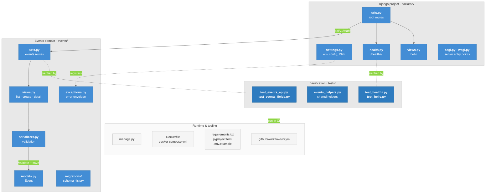

# Backend Code Organization

Where responsibilities live in `vip-web-backend`. Used on the **"Backend Organization"** presentation slide.

## Diagram

### Legend

- **Blue** = application code (project + events domain)
- **Darker blue** = tests
- **Light gray** = runtime and tooling
- **Solid arrow** = request path
- **Dashed arrow** = configuration
- **Dashed line** = verified by tests / run in CI

## Explanation

- **Django project (`backend/`)**: wires everything together. `settings.py` loads the env-driven config and registers the global exception handler. `urls.py` is the root router. `views.py` and `health.py` serve `/` and `/healthz/`. `asgi.py`/`wsgi.py` are the server entry points.
- **Events domain (`events/`)**: holds the API logic. A request flows urls → views → serializers → models, and the serializer validates the input and persists it through the `Event` model. `migrations/` is the schema history, and every DRF error is shaped by `exceptions.py` into `{code, message, details}`.
- **Verification (`tests/`)**: pytest-django suites that call the real HTTP routes. They verify the events API contract, the health endpoint and the hello view. `events_helpers.py` holds the shared constants and helpers.
- **Runtime & tooling**: supports the project without holding any business logic. `manage.py` runs Django commands, Docker runs it locally, `requirements.txt`/`pyproject.toml`/`.env.example` hold its dependencies and config, and CI runs lint, the migration check and pytest on every PR.

## Related Notes

- [[05-Component-Backend]]
- [[Project_Structure]]
