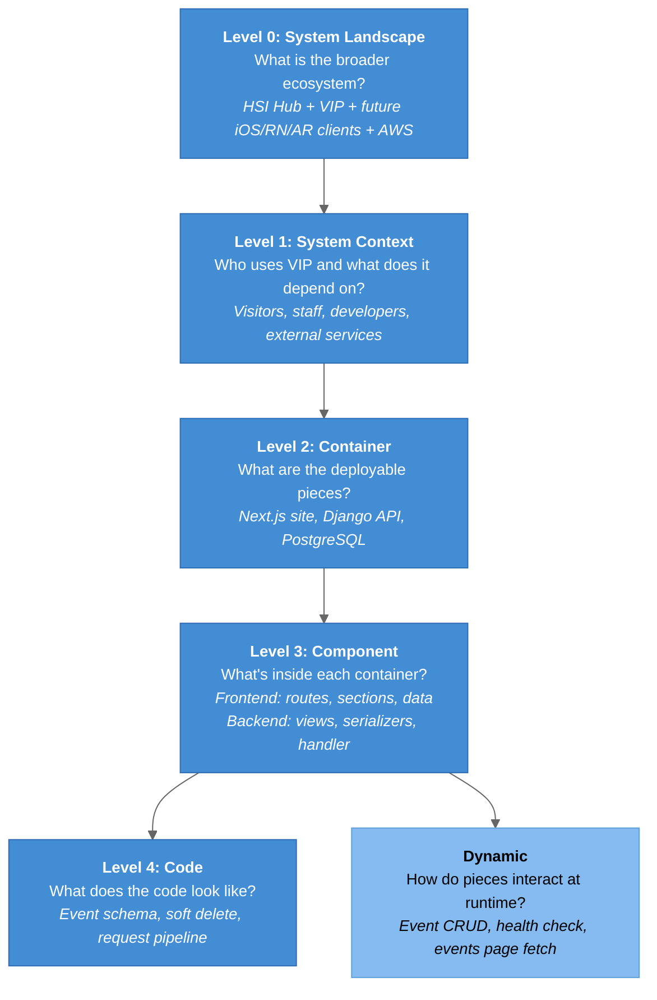

# C4 Model - VIP Architecture

## What is the C4 Model?

The C4 model (Context, Containers, Components, Code) is a set of hierarchical architecture diagrams created by Simon Brown. It gives four zoom levels for describing a software system, plus supplementary landscape and dynamic views.

## Diagram Index

| Level | Diagram | File | Description |
|-------|---------|------|-------------|
| **0** | [System Landscape](01-SystemLandscape.md) | `01-SystemLandscape.md` | HSI Innovation Hub ecosystem: VIP, future clients, AWS, CMS |
| **1** | [System Context](02-SystemContext.md) | `02-SystemContext.md` | VIP, its users, and external systems |
| **2** | [Container](03-Container.md) | `03-Container.md` | Next.js site, Django API, PostgreSQL, planned S3/CloudFront |
| **3a** | [Component (Frontend)](04-Component-Frontend.md) | `04-Component-Frontend.md` | Routes, sections, content data, providers, hooks |
| **3b** | [Component (Backend)](05-Component-Backend.md) | `05-Component-Backend.md` | URLconf, views, serializers, exception handler |
| **4** | [Code](06-Code.md) | `06-Code.md` | Event ER schema, soft-delete states, request pipeline |
| **Dyn** | [Dynamic](07-Dynamic-Diagrams.md) | `07-Dynamic-Diagrams.md` | Runtime flows |

## C4 Abstraction Levels



## Diagram Conventions

Every diagram starts with this init line:

```
%%{init: {'theme': 'base', 'flowchart': {'useMaxWidth': true}, 'themeVariables': {'primaryColor': '#438DD5', 'primaryTextColor': '#fff', 'lineColor': '#666', 'fontSize': '14px'}}}%%
```

| Element | Hex | Usage |
|---------|-----|-------|
| Users / Actors | `#08427B` | People who interact with the system |
| Main System | `#1168BD` | VIP as a whole |
| Containers / Components | `#438DD5` | What we build |
| External Systems | `#999` | Third-party or other systems |
| Planned | `#999` + `stroke-dasharray: 5 5` | Not built yet. Also drawn with dashed arrows `-.->` |
| Boundaries | `#E8E8E8` | Subgraph background |

Diagram types:

- `flowchart TD` for context, container, and component diagrams
- `sequenceDiagram` with `rect rgb(...)` blocks for dynamic flows
- `erDiagram` for the schema
- `stateDiagram-v2` / `classDiagram` for code level

## Key Architecture Decisions Visible in Diagrams

| Decision | Visible In | Diagram |
|----------|-----------|---------|
| Two independently deployable repos, coupled only by a REST contract | Container (L2) | Next.js ↔ Django over `/api/v1` |
| Django is the future shared data layer for web, iOS, RN, and AR clients | Landscape (L0) | Future clients point at the same API |
| Content/presentation split, so data swaps need no component changes | Component – Frontend (L3a) | `data/` → routes → sections |
| One error envelope `{code, message, details}` | Component – Backend (L3b) | `drf_exception_handler` |
| Soft delete by default, hard delete opt-in (`?permanent=true`) | Code (L4) | `deleted_at` state diagram |
| PATCH-only updates. Cross-field validation against merged state | Code (L4), Dynamic | Serializer `validate()` |
| Health check probes the DB, not just the process | Dynamic | `/healthz/` sequence |
| Server-side fetch for events, so no CORS for the proof of concept | Dynamic (planned) | Next.js server → Django |
| AWS hosting and S3 file access are planned, not built | Container, Landscape | Dashed gray nodes |
