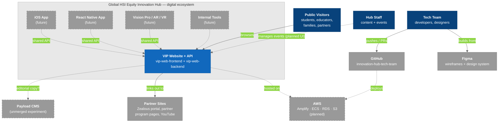

# C4 Model - Level 0: System Landscape

The broadest view: the Global HSI Equity Innovation Hub's digital ecosystem, where VIP sits in it, and which systems are current versus planned.

## Diagram

### Legend

- **Dark blue** = Users / Actors
- **Blue** = VIP (what we build today)
- **Gray** = External systems
- **Gray, dashed** = Future or planned

## Key Relationships

| Relationship | Protocol | Purpose |
|-------------|----------|---------|
| Visitors → VIP | HTTPS | Public website (Phase 1) |
| Staff → VIP | HTTPS (planned admin/staff UI) | Manage events. Today this is done by hand through Swagger/Postman |
| Future clients → VIP API | REST `/api/v1` | Django becomes the shared business-logic layer |
| VIP → AWS | — | Planned hosting. See [[AWS_Architecture]] |
| VIP → Payload CMS | Direct DB (unmerged) | Ownership unresolved. See [[Payload_CMS_Branch]] |
| Tech team → Figma | Figma MCP (read-only) | Design source of truth |
