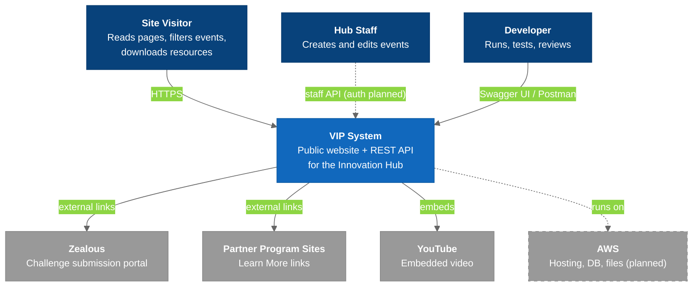

# C4 Model - Level 1: System Context

VIP as one box: who uses it and which external systems it depends on.

## Diagram

### Legend

- **Dark blue** = Users / Actors
- **Blue** = VIP system (what we build)
- **Gray** = External systems
- **Gray, dashed** = Planned

## Key Relationships

| Relationship | Protocol | Purpose |
|-------------|----------|---------|
| Visitor → VIP | HTTPS | Browse the site. Download PDFs from `public/files/` today, S3 later |
| Staff → VIP | REST `/api/v1/staff/events` | Event CRUD. No auth yet |
| Developer → VIP | `/api/docs/`, Postman | Explore and test the API |
| VIP → Zealous | Link (new tab) | Challenge "Submit" CTA |
| VIP → Partner sites | Link (new tab) | The Source "Learn More" |
| VIP → YouTube | Embed / lightbox | Video sections (`lib/youtube.ts`) |
| VIP → AWS | — | Planned. See [[AWS_Architecture]] |
