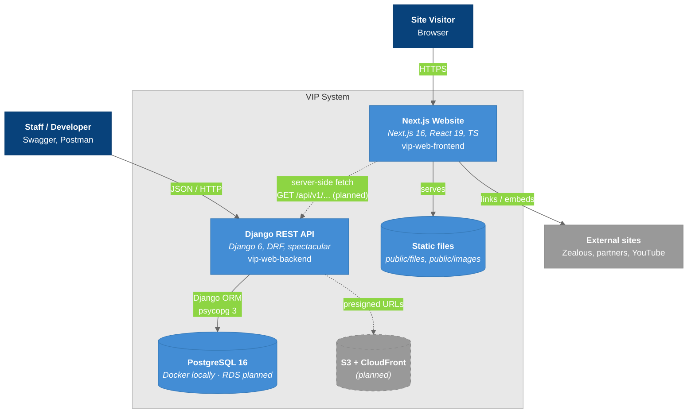

# C4 Model - Level 2: Container Diagram

The deployable building blocks of VIP and how they communicate. Solid lines exist today; dashed lines are planned.

## Diagram

### Legend

- **Dark blue** = Users
- **Blue** = VIP containers (what we build and deploy)
- **Gray** = External systems
- **Gray, dashed** = Planned
- **Light border** = System boundary

## Container Details

| Container | Technology | Purpose | Port (dev) | Status |
|-----------|-----------|---------|------------|--------|
| **Next.js Website** | Next.js 16 App Router, Tailwind 4, shadcn/ui, Motion | Public site. Content from `data/` | 3000 | Current. Amplify planned |
| **Django REST API** | Django 6, DRF 3.17, drf-spectacular | Events API, health, OpenAPI | 8000 | Current. ECS planned |
| **PostgreSQL** | postgres:16, psycopg 3 | Persistent data | 5433 on host / 5432 in compose | Current. RDS planned |
| **Static files** | Next.js `public/` | Images, downloadable PDFs | — | Current |
| **S3 + CloudFront** | AWS | Tracked or protected file access | — | Planned |

## Data Flow Summary

| Flow | Direction | Data | Format |
|------|-----------|------|--------|
| Browser → Next.js | Request | Page views | HTML/RSC |
| Next.js → Django | Request (planned) | `GET /api/v1/events` | JSON |
| Staff → Django | CRUD | Events | JSON. Errors use the `{code, message, details}` envelope |
| Django → Postgres | Query | ORM SQL | TCP / PostgreSQL protocol |
| Django → S3 | Planned | Presigned download URLs | AWS SDK |

## Key Relationships

| Relationship | Protocol | Purpose |
|-------------|----------|---------|
| Website ↔ API | REST, versioned `/api/v1` | The only coupling between the repos |
| API ↔ DB | Django ORM | All persistence |
| Website ↔ DB | **none** | The frontend never talks to the DB directly (except the unmerged [[Payload_CMS_Branch]]) |
