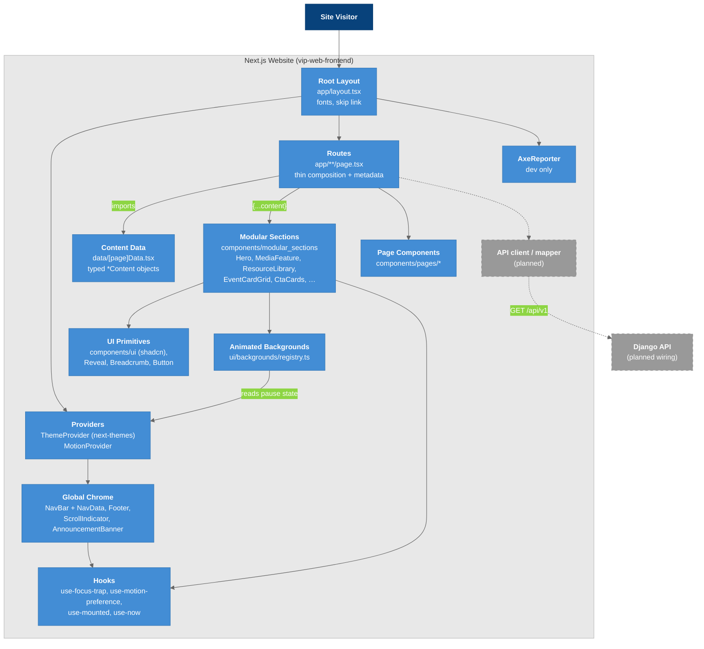

# C4 Model - Level 3a: Component Diagram (Frontend)

Inside the Next.js website: the root layout and providers, routes, section components, content data, and shared hooks and UI.

## Diagram

### Legend

- **Dark blue** = Users
- **Blue** = Frontend components (what we build)
- **Gray, dashed** = Planned

## Component Details

| Component | Location | Responsibility |
|-----------|----------|----------------|
| Root Layout | `app/layout.tsx` | Fonts, `<main id="main-content">`, skip link, providers |
| Providers | `components/theme-provider.tsx`, `components/MotionProvider.tsx` | Theme class; reduced-motion + background pause state |
| Global Chrome | `components/global/*` | Nav tree from `NavData.ts`, footer, scroll indicator |
| Routes | `app/**/page.tsx` | Compose sections from content |
| Content Data | `data/*` | All copy, links, and image paths. JSON-serializable |
| Modular Sections | `components/modular_sections/*` | Pure `XProps` sections. See [[Modular_Sections]] |
| Page Components | `components/pages/*` | Page-specific pieces (About, Home, Resources) |
| UI Primitives | `components/ui/*` | shadcn + local primitives |
| Backgrounds | `components/ui/backgrounds/*` | Registry of canvas/WebGL effects |
| API client | — | **Planned**: a server-side fetch + mapper for `/events` |

## Key Relationships

| Relationship | Protocol | Purpose |
|-------------|----------|---------|
| Routes → Data | ES import | Today's content source |
| Routes → Sections | Props spread | Content/presentation split ([[Content_Data_Contract]]) |
| Sections → Providers | React context | Motion preference, theme |
| Routes → API | `fetch` in a Server Component (planned) | Replaces `data/eventsData.tsx` for events |
