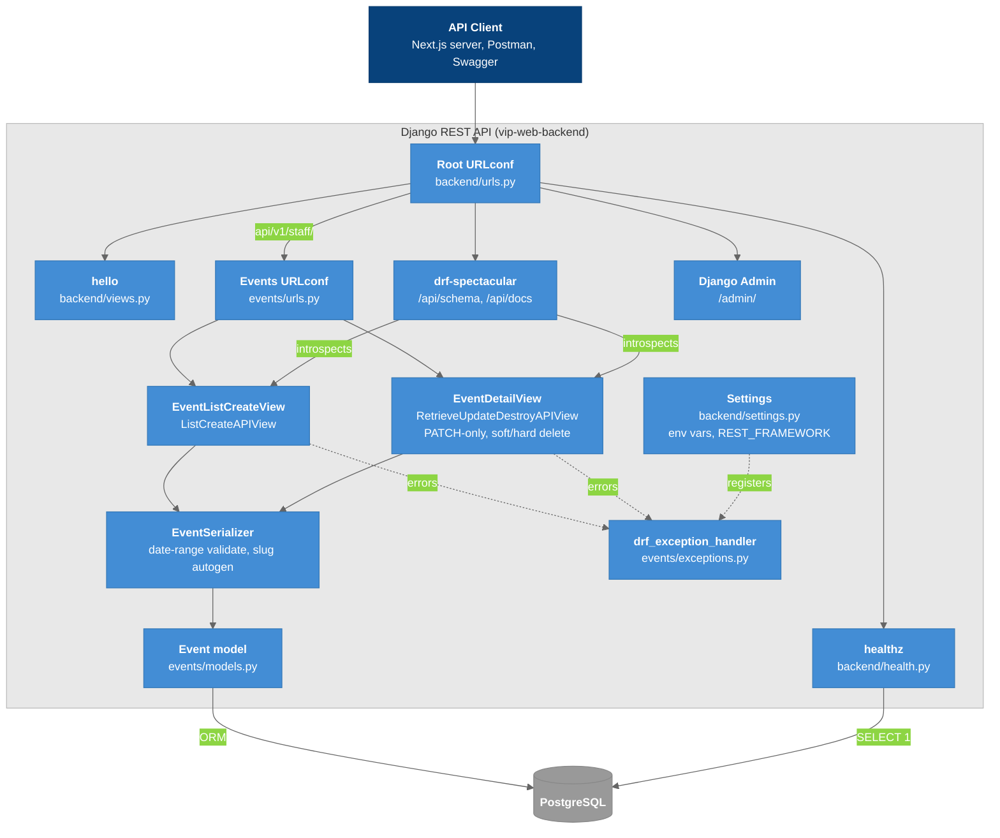

# C4 Model - Level 3b: Component Diagram (Backend)

Inside the Django REST API: the URLconf, views, serializers, model, exception handler, schema generator, and health probe.

## Diagram

### Legend

- **Dark blue** = Clients
- **Blue** = Backend components (what we build)
- **Gray** = Database container
- **Dashed arrow** = error path / configuration

In this diagram the dashed arrows mean error paths or configuration, not "planned."

## Component Details

| Component | File | Responsibility |
|-----------|------|----------------|
| Root URLconf | `backend/urls.py` | `/`, `/healthz/`, `/api/v1/staff/`, `/api/schema/`, `/api/docs/`, `/admin/` |
| Events views | `events/views.py` | List/create, and retrieve/PATCH/delete over live rows (`deleted_at IS NULL`) |
| EventSerializer | `events/serializers.py` | Field exposure, read-only fields, `end >= start` on merged state, slug on create |
| Event model | `events/models.py` | Schema, `soft_delete()`, `generate_unique_slug()` |
| Exception handler | `events/exceptions.py` | [[Error_Envelope]] |
| Schema | drf-spectacular | [[OpenAPI_Swagger]] |
| Health | `backend/health.py` | [[Health_Endpoints]] |

Not present yet: authentication or permissions, pagination, CORS, a public read-only events route, file storage.

## Key Relationships

| Relationship | Protocol | Purpose |
|-------------|----------|---------|
| Views → Serializer | DRF | Validation and representation |
| Serializer → Model | ORM | Persistence |
| Views → Handler | DRF `EXCEPTION_HANDLER` | Uniform errors |
| spectacular → Views | Introspection | OpenAPI 3 schema |
