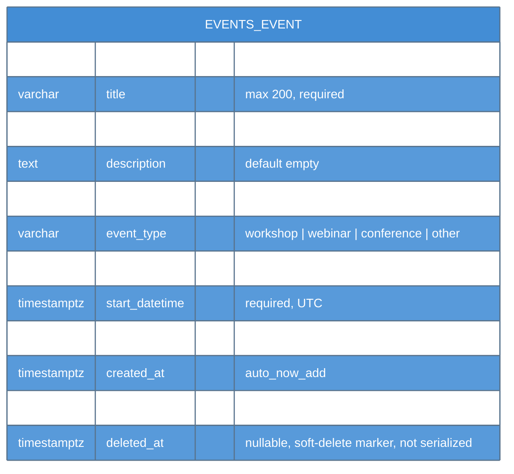
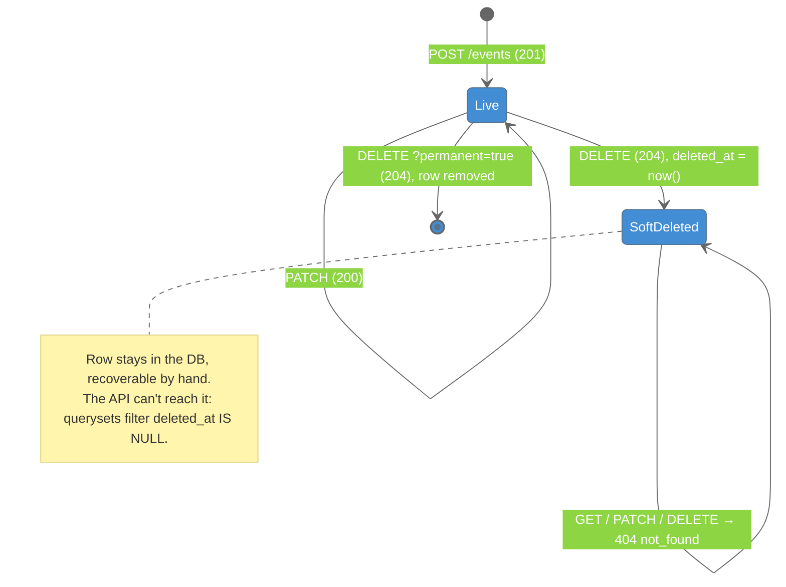
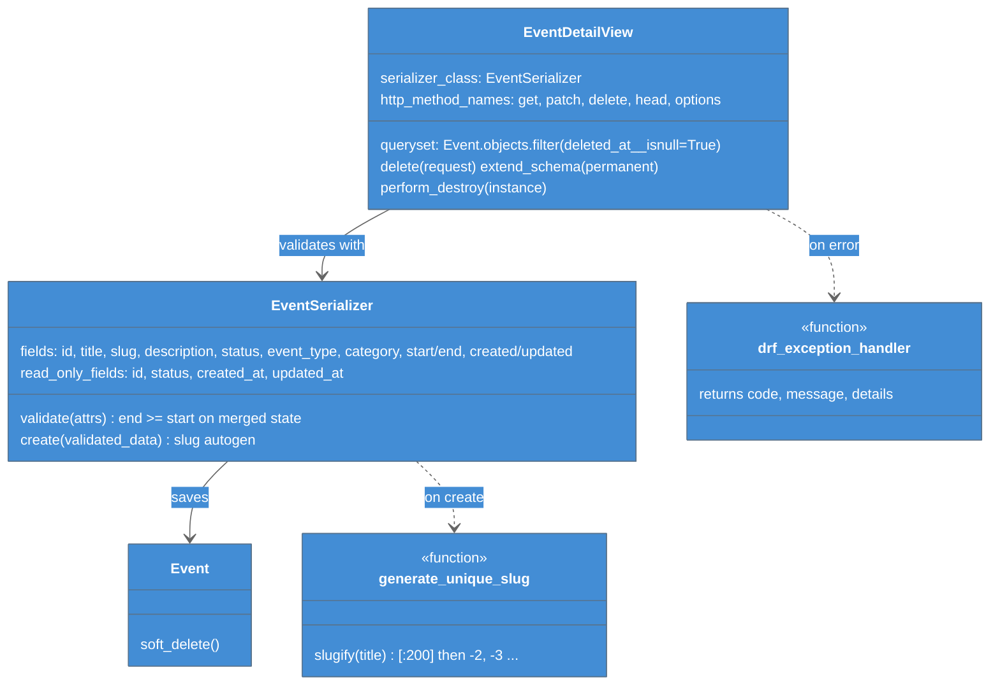
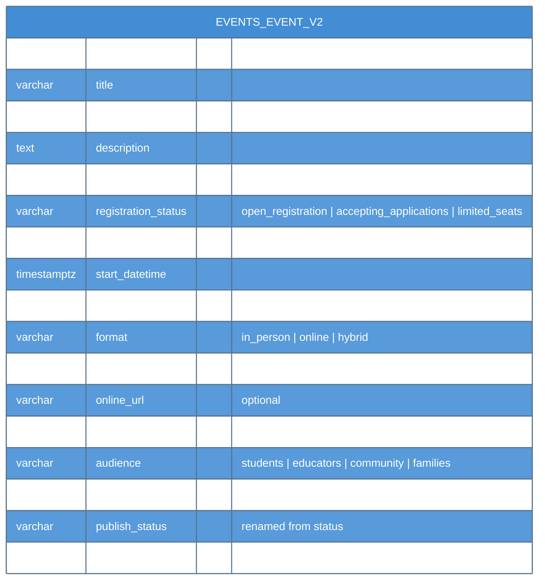

# C4 Model - Level 4: Code

Code-level detail for the backend: the Event schema, the soft-delete lifecycle, the request pipeline for a PATCH, and the proposed v2 schema.

## 1. Database Schema — `Event` (current)

Migrations: `0001_initial`, then `0002_event_deleted_at`.

## 2. Soft-Delete Lifecycle

## 3. Request Pipeline — PATCH `/api/v1/staff/events/<uuid>`

## 4. Proposed v2 Schema *(planned — not built)*

From [[OneOnOne_2026-09-25_Backend_Infra]]. It is pending supervisor answers, so treat field names as proposals.

## Related Notes

- [[Events_API]]
- [[Error_Envelope]]
- [[Events_API_Integration]]
