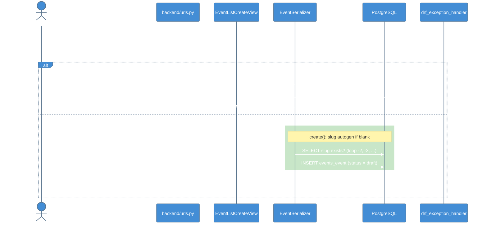
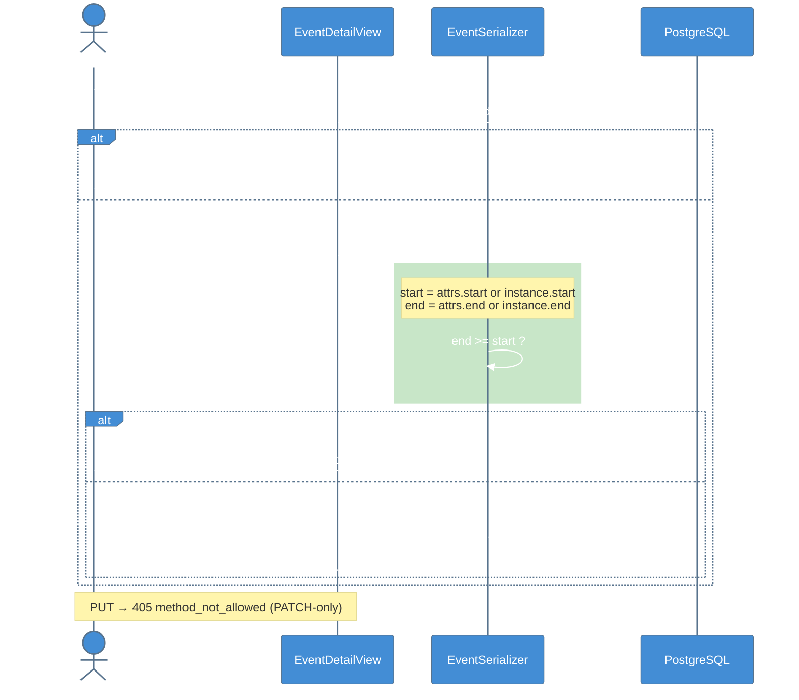
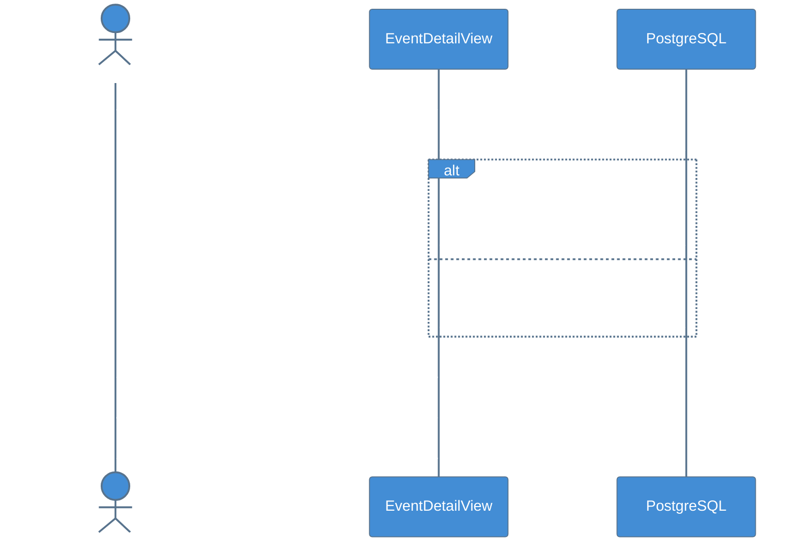
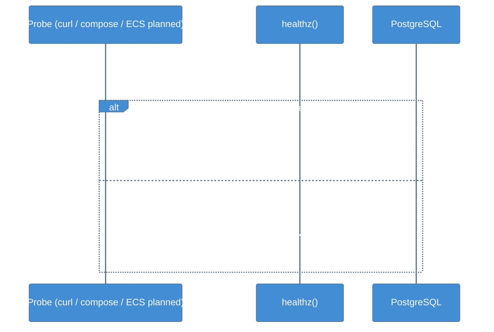
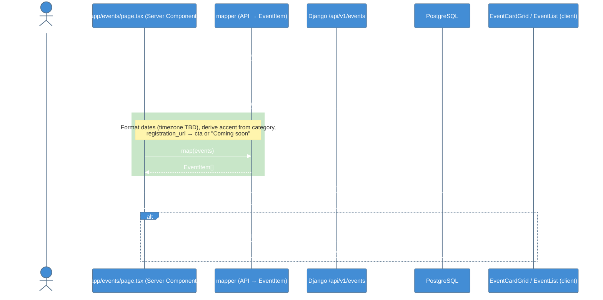

# C4 Model - Dynamic Diagrams

Runtime behavior through key interaction flows. Flows 1–4 exist today. Flow 5 is planned.

## 1. Create Event

## 2. Partial Update (PATCH) with Merged-State Validation

## 3. Delete — Soft by Default, Hard on Request

## 4. Health Check

## 5. Events Page Reads the API *(planned — proof of concept)*

From [[OneOnOne_2026-09-25_Backend_Infra]]. The fetch runs on the Next.js server, so there's no browser-to-Django call and no CORS.

## Related Notes

- [[Events_API]]
- [[Events_Page]]
- [[Health_Endpoints]]
- [[Events_API_Integration]]
